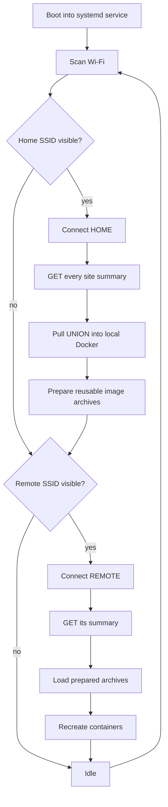

# DockerGo (Raspberry Pi edition)

Sneakernet Docker updater for a **Raspberry Pi 4** with a **GeeekPi 3.5" SPI
touch LCD**. It pre-downloads Docker images on a high-bandwidth *home* network,
is physically carried to low-bandwidth remote sites, then uploads the images to
each site's Docker daemon and recreates the affected containers — all narrated
on the LCD and (optionally) a Discord webhook.

This is a Python port of the original [ESP32-S3 / LILYGO T-Dongle firmware](https://github.com/mayberryjp/dockergo).
Because the Pi runs a **real Docker engine**, the firmware's hand-rolled
Registry-V2 client, content-addressed blob store and OCI archive assembly are
gone — replaced by `docker pull` / `save` / `load` via the Docker SDK.

## How it works



The Pi's **local Docker image store is the cache** — images pulled at home stay
there while remote sites still need them. The Pi never *runs* these images, it only
carries them, so it happily pulls `linux/amd64` images for your Intel sites even
though the Pi itself is arm64.

At home, DockerGo checks each requested reference against the registry and
exports it to `/var/lib/dockergo/image-archives`. Archives are keyed by the
reference and exact image ID: unchanged images reuse their archive across
home syncs and remote sites. New image IDs get new archives, and old versions
are removed only after the replacement export succeeds. Failed exports are
never published as ready archives.

Remote sites receive and load these prepared archives; the Pi does not export
again at each site. The loaded image ID must match the cached image before
containers are recreated using that exact ID. If an archive is missing, the
transfer is skipped until a home sync prepares it. No remote configuration
changes are required. Allow disk space for both Docker's image store and the
uncompressed archives; the first home sync after upgrading prepares archives
for images already cached.

At each remote site, prepared archives are uploaded **smallest first**, by
actual archive byte size (not registry compressed size). Missing archives are
reported and skipped. The LCD has a dedicated, prominent byte counter,
MiB/s and B/s, elapsed time, and time since bytes last changed. Counters appear
immediately and refresh once per second, including when an operation is blocked;
the rate drops to zero during a stall and the counters turn yellow after five
seconds without byte progress. Upload bytes measure data handed to the HTTP transport, not
remote acknowledgements. Once the payload has been handed off, the screen
shows **Loading/verifying**: 100% bytes does not mean the image is ready.
Containers are only recreated after the remote image ID is verified.

Home downloads also report Docker's per-layer byte counts: compressed registry
downloads and uncompressed extraction are tracked **separately**, so extraction
does not reset or inflate download counters. Docker reveals layer totals as it
discovers them, so the displayed total/percentage may change during a pull.
Archive preparation shows actual bytes written to the tar file. Its exact total
is unknown until export finishes, so it shows `total unknown` rather than a
made-up percentage. Cached archives show their verified local file size without
exporting again.

Each transfer runs in a disposable worker process. No upload byte progress for
120 seconds aborts the upload. After the payload is handed off, daemon loading
and verification have a separate 600-second deadline, even if the daemon keeps
emitting messages. A 7200-second overall deadline bounds the entire operation.
Failed transfers do not restart containers; other images are still attempted,
the site is marked incomplete, and pending images are retried next cycle.
Disconnecting cannot cancel work already accepted by Docker; the remote daemon
may finish a load after DockerGo has timed out.

Diagnostics are written to `/var/log/dockergo/dockergo.log` and stderr
(systemd journal). The file rotates at 5 MiB with three backups. The file includes
DEBUG-level per-layer Docker events (layer ID, status, current and total bytes),
while stderr remains INFO-level. Neither telemetry nor these diagnostics is
sent to Discord; Discord still receives only high-level announcements.
Logs include pull platform/image IDs, archive lookup/reuse and temporary paths,
partial export cleanup, upload order/sizes, timeout settings, worker PID/exit
status, daemon connection/load/verification stages and output, and full exception
tracebacks. Exact-byte transfer statistics are recorded **every second**, even
when no bytes move, plus initial/final counters for short operations.
Display render/write failures are logged rather than silently ignored. Use
`sudo tail -f /var/log/dockergo/dockergo.log` to watch, or override the path
with `--log-file dockergo.log` when developing without root.
After deployment, look for `Detailed byte telemetry enabled` at startup to
confirm the rebuilt package is running.

During a home sync, DockerGo also removes previously cached image references
that no remote site's latest summary needs. It only removes references it has
tracked in `/var/lib/dockergo/cached-images.json`, and Docker is not asked to
force-remove an image still used by a local container. Cleanup is skipped for a
cycle if any remote summary cannot be fetched or validated, so incomplete site
data cannot cause cached images to be discarded. Removing a managed image
reference also removes its reusable archives.

## Hardware

| Part | Detail |
| --- | --- |
| Board | Raspberry Pi 4B |
| Display | GeeekPi 3.5" SPI resistive TFT (ILI9486 / XPT2046, 480×320) on the 40-pin header |
| OS | Raspberry Pi OS Bookworm, **64-bit Lite** recommended |

The panel appears as a secondary framebuffer (`/dev/fb1`). DockerGo composes each
frame with Pillow and writes raw pixels to it — no desktop, no X/SDL — so it boots
straight into a dedicated status screen.

## Install (on the Pi)

```bash
git clone <this-repo> dockergo && cd dockergo
sudo bash scripts/install.sh
# edit your sites / Wi-Fi:
sudo nano /boot/firmware/dockergo/config.json
sudo reboot
```

The installer adds the panel overlay, applies seamless-boot tweaks, installs the
package globally, writes a config template to the boot partition, and enables a
systemd service that launches the app on every boot. Before DockerGo starts,
the updater makes a bounded attempt to fast-forward this checkout, verifies the
installed package, and rebuilds it from a clean wheel if needed. If GitHub is
offline, a matching installed package or a successful local rebuild lets the
app start. The updater retries every 15 minutes; a successful update while the
app is running restarts DockerGo.

For an existing installation, pull this update and run `sudo bash scripts/install.sh`
once to install and enable the updater service and timer.

> **Panel driver note:** the installer enables the `mhs35` overlay used by the
> high-speed GeeekPi/Waveshare 3.5". If the screen stays white, install the
> vendor driver (`goodtft/LCD-show` → `MHS35-show`) or switch the overlay to
> `tft35a` for a plain ILI9486. See comments in [scripts/install.sh](scripts/install.sh).

## Update / rebuild (on the Pi)

For an existing installation, first pull the pushed commit, then use the same
clean-wheel deployment helper as the boot updater:

```bash
sudo systemctl stop dockergo
REPO=/home/mayberry/docker-updater-pi
OWNER=$(stat -c '%U' "$REPO")
runuser -u "$OWNER" -- git -C "$REPO" pull --ff-only origin main
git -C "$REPO" log -1 --oneline
sudo bash "$REPO/scripts/deploy_package.sh" "$REPO" no-deps
sudo systemctl reset-failed dockergo
sudo systemctl start dockergo
sudo journalctl -fu dockergo
```

The helper removes stale setuptools build output, builds a wheel, checks every
wheel module against the checkout before installing it, then checks the
installed modules and smoke-imports the systemd entry point. It exits nonzero
on any mismatch; do not start DockerGo until it prints that deployment passed.

## Configuration

Config is JSON on the boot partition (editable from any PC):
`/boot/firmware/dockergo/config.json`. See [config.example.json](config.example.json).

| Field | Meaning |
| --- | --- |
| `device_name` | Shown on the LCD and used as the Discord username |
| `image_platform` | Manifest-list platform selector (default `linux/amd64`) |
| `discord_webhook` | Optional webhook for mirrored status lines |
| `poll_interval` | Seconds between Wi-Fi scan cycles |
| `upload_stall_timeout` | Positive integer seconds without upload byte progress (default 120) |
| `image_load_timeout` | Positive integer seconds for daemon loading/verification after payload handoff (default 600) |
| `transfer_timeout` | Positive integer overall transfer deadline in seconds (default 7200) |
| `sites[]` | `name`, `home` (one or more; first site defaults to home if none are marked), `ssid`, `password`, `docker_api`, `summary_url`, optional `wireguard_connection` on a home site |

For an emergency home hotspot that reaches remotes over WireGuard, set
`"wireguard_connection": "dockergo-emergency"` on that home site. Create a
matching WireGuard connection in NetworkManager and disable its autoconnect.
When that home SSID is visible, DockerGo can use the tunnel to read remote
summaries and download needed images into the Pi's local Docker store. Home
cycles never upload images or update remote daemons, even if a remote Wi-Fi
SSID is also visible. The tunnel stays up while the configured home Wi-Fi is
connected; a NetworkManager dispatcher guard removes it when `wlan0` leaves
that SSID, including if DockerGo stops unexpectedly. Remote `summary_url`
addresses must be routed through the tunnel. Remote daemons are updated only
on remote-only cycles, when no configured home SSID is visible.

Each site exposes a summary endpoint returning the images it still needs:

```json
{ "checks": { "docker_updater": { "pending_images": ["ghcr.io/.../frigate:stable"] } } }
```

Remote daemons only need to expose their API over the network (`docker_api`,
e.g. `tcp://10.0.0.2:2375`). Unlike the firmware, **no containerd/snapshotter
reconfiguration is required** — DockerGo uses the daemon's native `save`/`load`
format, which any Docker engine accepts.

## Running / developing

```bash
# On the Pi, foreground (service must be stopped first):
sudo systemctl stop dockergo
sudo python3 -m dockergo --config /boot/firmware/dockergo/config.json

# One cycle then exit:
sudo python3 -m dockergo --once

# Preview the LCD UI anywhere (writes dockergo-frame.png, no panel needed):
pip install pillow numpy requests docker
python -m dockergo --mock-display --once --config config.json --log-file dockergo.log
```

Useful flags: `--fb /dev/fb0`, `--interval 30`, `--mock-display`.

## Project layout

| Module | Responsibility |
| --- | --- |
| [dockergo/config.py](dockergo/config.py) | Load/validate `config.json` |
| [dockergo/status.py](dockergo/status.py) | Thread-safe status shared with the display |
| [dockergo/display/framebuffer.py](dockergo/display/framebuffer.py) | Pillow → `/dev/fb1` writer (PNG fallback off-device) |
| [dockergo/display/ui.py](dockergo/display/ui.py) | Status screen layout |
| [dockergo/wifi.py](dockergo/wifi.py) | nmcli scan / prioritized connect |
| [dockergo/summary.py](dockergo/summary.py) | Fetch `pending_images` |
| [dockergo/docker_ops.py](dockergo/docker_ops.py) | pull / transfer / recreate via the Docker SDK |
| [dockergo/discord.py](dockergo/discord.py) | Batched webhook mirror |
| [dockergo/orchestrator.py](dockergo/orchestrator.py) | Home-first state machine |
| [dockergo/__main__.py](dockergo/__main__.py) | Display thread + loop wiring |
